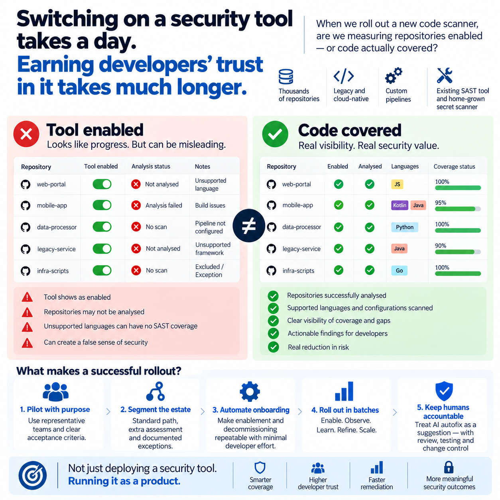

  
Portfolio · Security product &amp; programme leadership

  <h1>PANKHURI MISHRA</h1>
  
Product Manager · Application Security &amp; Vulnerability Management

  
SAST · SCA · Secrets · CI/CD security · Triage &amp; remediation · Security platforms run as products

  
20 years. Several transitions. One constant: outcome.

  
I turn security tools into programmes that engineers actually adopt, and I measure success by vulnerabilities fixed, not alerts raised. Most recently I was AGM – Technology Product Manager for Application Security and Vulnerability Management at John Deere, owning the platforms used by thousands of developers. Before that: four years owning a global product, two years building a team from scratch, and 14 years in engineering and IBM technical leadership.

  
Based in Pune, India · open to roles in Pune, elsewhere in India (open to relocating within India), or remote.

  

    <a class="btn primary" href="#contact">Get in touch</a>
    <a class="btn ghost" href="#case-studies">Read the case studies</a>
  

<section class="block" id="impact">
  
Application security &amp; vulnerability management · Dec 2024 – Sep 2026

  <h2>Impact at a glance</h2>
  
I owned the strategy, roadmap and backlog for five application security and vulnerability management platform products used across the enterprise.

  

    

Enterprise-wide

An enterprise code-scanning platform (SAST, secret scanning, push protection) rolled out to thousands of developers

    

4 months

Batched enterprise rollout, <b>a month ahead of plan</b>, after evaluation, pilot and false-positive tuning in earlier quarters

    

~2x

Application security findings fixed within SLA, roughly doubled

    

Two tools → one

Legacy tools retired, with a major cut in annual licence cost

    

Hundreds

of secrets blocked by push protection before they reached the codebase

    

CISO Award

The company's annual award, given to the rollout team I was part of

    

Near-complete

Repository coverage in the targeted departments, and near-complete asset coverage in vulnerability management

    

AI fix PRs

Guardrails and success criteria for an AI remediation programme; most AI-raised fix pull requests were accepted

    

~100

Security champions across departments who carried adoption

  

  
How the work was set up: I reported to a Group Product Manager in the CISO organisation, led AppSec and VM people functionally across India and the US, and delivered through a new AppSec engineering team built by my engineering manager. I owned the roadmap, priorities, evaluation criteria, timelines, adoption metrics and the SLA policy.

</section>

<section class="block" id="work">
  
Flagship work

  <h2>Selected work</h2>
  

    

01 · Application security
<h3>Rolling out a code security platform to thousands of developers</h3>
Evaluation criteria, a phased pilot, a Go / No-Go recommendation, batch rollout, noise reduction, CI/CD hardening and a champions network. Live a month early.
<a class="more" href="selected-work/security-tool-rollout-at-scale.html">Read the story →</a>

    

02 · Triage &amp; remediation
<h3>From finding to fix</h3>
The rules and workflow that decided what analysts and developers saw first: risk-weighted routing, SLAs, exceptions, open-source risk and AI-assisted fixes with human review.
<a class="more" href="selected-work/finding-to-fix.html">Read the story →</a>

    

03 · Building teams
<h3>Insourcing a service from vendors, a month and a half early</h3>
Built a team from scratch (13 hires) to take Content Shared Services for two regions back in-house, running ahead of plan.
<a class="more" href="selected-work/vendor-insourcing.html">Read the story →</a>

    

04 · Product leadership
<h3>Modernising a legacy product for 500 users</h3>
Product owner for two Scrum teams: replaced 20+ years of legacy systems, made content delivery 10x faster and saved 4,500 hours a year.
<a class="more" href="selected-work/process-reengineering-savings.html">Read the story →</a>

  

</section>

<section class="block" id="playbook">
  
How I run a rollout

  <h2>Enabled is not covered</h2>
  

    

      
Switching on a security tool takes a day. Earning developers' trust in it takes much longer. This is the playbook I used for code scanning, and reused for the endpoint platform rollout.

      <ul>
        <li><b>Pilot with purpose:</b> representative teams and clear acceptance criteria.</li>
        <li><b>Segment the estate:</b> a standard path, extra assessment and documented exceptions.</li>
        <li><b>Automate onboarding:</b> enablement and decommissioning with minimal developer effort.</li>
        <li><b>Roll out in batches:</b> enable, observe, learn, refine, scale.</li>
        <li><b>Keep humans accountable:</b> AI autofix is a suggestion, with review, testing and change control.</li>
      </ul>
      
If adoption of a security tool has stalled, the problem is rarely the tool. It is the rollout plan, the ownership and the metrics.

    

    
  

</section>

<section class="block" id="case-studies">
  
How I think

  <h2>Case studies</h2>
  
Seven write-ups on the questions security programmes get stuck on, with scripts and templates.

  

    

Vulnerability management
<h3>Exploit-driven prioritisation</h3>
How do you stop spending patch time on flaws nobody exploits?

EPSS + CISA KEV + asset context, with a working prioritiser script.
<a class="more" href="case-studies/CS01-Exploit-Driven-Vulnerability-Prioritization/">Read →</a>

    

Application security
<h3>Scaling a code-scanning platform across a large enterprise</h3>
How do you add an AppSec platform without coverage gaps, duplicate alerts or developer fatigue?
<a class="more" href="case-studies/CS35-GitHub-Advanced-Security-Enterprise-Rollout/">Read →</a>

    

Programme design
<h3>A security testing programme beyond scanners</h3>
Which testing does each application need, and how do findings actually get fixed?
<a class="more" href="case-studies/CS53-Security-Testing-Programme-Beyond-Scanners/">Read →</a>

    

Product &amp; adoption
<h3>Why security tools fail to land</h3>
What stops a bought tool from being adopted, and what must vendors fix to scale across customers?

Includes adoption scorecards.
<a class="more" href="case-studies/CS50-Security-Tool-Adoption-and-Vendor-Scaling/">Read →</a>

    

Governance
<h3>Running a penetration testing programme</h3>
How do you scope, govern and close out pen tests so the same findings stop coming back?

Includes governance templates.
<a class="more" href="case-studies/CS47-Penetration-Testing-Programme-Management/">Read →</a>

    

Application security
<h3>AppSec debt and the developer ratio</h3>
How does a small AppSec team cover hundreds of developers?

Paved roads, champions and risk-based triage.
<a class="more" href="case-studies/CS25-AppSec-Debt-and-Developer-Ratio/">Read →</a>

    

Privacy &amp; compliance
<h3>DPDP Act readiness for banks and NBFCs</h3>
How do you turn India's data protection law into controls, owners and evidence that stay current?
<a class="more" href="case-studies/CS34-FS-DPDP-Act-Readiness-Automation/">Read →</a>

  

</section>

<section class="block" id="career">
  
Career arc · 2004 – 2026

  <h2>Each move into a new domain, delivered</h2>
  
I step into new domains, learn them fast and deliver. The same habits carried from code to teams to product to security.

  

    

2004 – 2018 · HCL, Infosys, IBM
<h3>The foundation: developer to technical lead</h3>
Java/J2EE and Documentum ECM engineering, then IBM's client-facing technical lead for John Deere: <b>16 developers across India, Mexico and the US</b> on Deere.com and MyJohnDeere.com, live in 40+ countries and 20+ languages.

    

2018 – 2020 · John Deere · Associate Project Manager
<h3>Building from scratch: vendor insourcing</h3>
Built the Content Shared Services team with <b>13 hires</b>. Took content authoring for two regions in-house from vendors <b>1.5 months ahead of plan</b>, and rolled out national dealer websites in 10+ countries in seven months.

    

2020 – 2024 · John Deere · Technology Product Manager
<h3>Product leadership: Parts Information platform</h3>
Product owner for two Scrum teams serving <b>500 users worldwide</b>, ~24 releases a year. Made the business case for a decoupled architecture, ran a vendor proof of concept and won investment approval, then replaced 20+ years of legacy systems: <b>content delivered 10x faster</b>, <b>4,500 hours a year saved</b>.

    

2024 – 2026 · John Deere · AGM – Technology Product Manager
<h3>A new domain: application security transformation</h3>
Moved into the CISO organisation to own AppSec and VM platforms. Legacy tools replaced ahead of plan, AppSec findings fixed within SLA roughly doubled, and a team <b>CISO Award</b>.

    

What's next
<h3>Product strategy for security</h3>
Owning a security product or platform where the practitioner's day-to-day decides the roadmap, and where AI is changing how code is written and secured.

  

</section>

<section class="block" id="learning">
  
Credentials &amp; principles

  <h2>How I lead, and how I keep learning</h2>
  

    

      <h3>How I lead</h3>
      <ul>
        <li><b>Treat the security platform as a product.</b> Evaluation criteria, a pilot, a roadmap, adoption metrics and a named owner.</li>
        <li><b>Measure outcomes, not activity.</b> Coverage, time to fix and SLA performance, not findings closed.</li>
        <li><b>Make the secure path the easy path.</b> Zero-touch onboarding, champions and clear exceptions beat mandates.</li>
        <li><b>Influence without authority.</b> Most of the people who fix findings never report to security.</li>
        <li><b>Leave it running.</b> Playbooks, dashboards and owners the team keeps using after the project ends.</li>
      </ul>
    

    

      <h3>Certifications &amp; education</h3>
      <ul>
        <li>Certified Scrum Product Owner (CSPO), renewed November 2026</li>
        <li>Professional Certificate Programme in Cybersecurity and AI, IIT Madras, 2026: <a href="https://github.com/pankhuri-labs/course-projects-assignments/tree/main/iitm-cybersecurity-ai-2026">seven hands-on security projects</a></li>
        <li>Executive PG Programme in ML &amp; AI, IIIT Bangalore, 2022: <a href="https://github.com/pankhuri-labs/course-projects-assignments/tree/main/iiitb-ml-ai-2022">seven ML projects</a></li>
        <li>MCA, Rajeev Gandhi University, 2004 · B.Sc. Statistics, Barkatullah University, 1999</li>
      </ul>
      <h3>Toolkit</h3>
      
Roadmaps &amp; PRDsDiscovery &amp; pilotsScrum · Kanban · SAFe PIJira · Confluence · RallySQL · Power BIOWASP Top 10 · ASVSNIST CSF 2.0Threat modelling

    

  

  
More about my background: <a href="about.html">About me</a> · Occasional advisory work: <a href="advisory.html">Advisory</a>

</section>

<section id="contact">
  

    

      
Let's talk

      
Let's build what's next.

    

    

      <a href="mailto:pankhuri.awasthi@gmail.com">pankhuri.awasthi@gmail.com</a> 
      <a href="https://www.linkedin.com/in/pankhurimishra/">linkedin.com/in/pankhurimishra</a> 
      Pune, India · open to relocating within India
    

  

</section>
