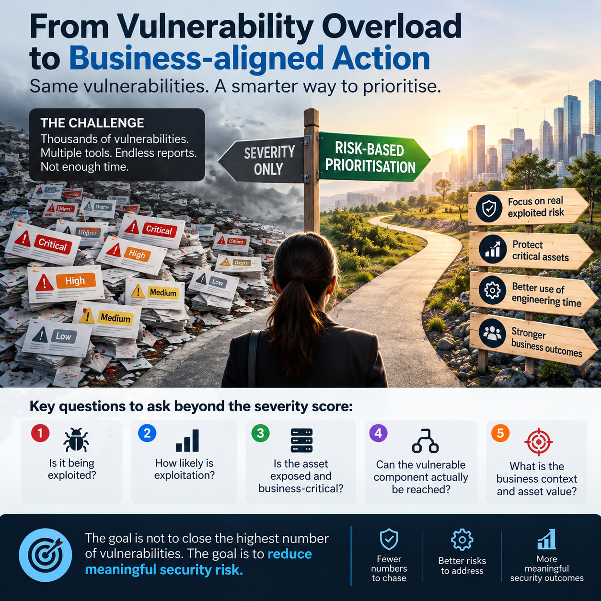

# CS01: Exploit-Driven Vulnerability Prioritisation

**Domain: cross-industry** · Org type: product and services

> **In short**
> - **The problem:** tens of thousands of open findings and SLAs written on CVSS, so patch time goes to flaws nobody is exploiting.
> - **The approach:** rank findings on exploitation evidence (CISA KEV, EPSS), exposure, asset criticality and reachability, with an SLA per outcome.
> - **The proof:** a working prioritiser script in [`prioritizer/`](prioritizer/) that turns any scanner's CSV export into a ranked, explained action list.
> - **For your team:** this is the core of my **vulnerability management health check**.



## 1. Problem statement

Vulnerability programmes are drowning. A mid-size enterprise or a services provider covering many clients typically holds tens of thousands of open findings across hosts, containers and code dependencies, and SLAs are written on CVSS severity ("criticals in 15 days"). CVSS measures how bad a flaw *could* be, not whether anyone is exploiting it, so teams spend scarce patch windows on findings that will never be attacked while actively exploited CVEs sit in the queue.

Only a small fraction of published CVEs are ever exploited in the wild. FIRST's EPSS research and the size of CISA's KEV catalogue (roughly 1,500 entries against well over 250,000 published CVEs) both point the same way: a few percent of CVEs carry most of the real risk.

## 2. Why now

- **Exploitation is fast and frequent.** Verizon DBIR 2025 puts vulnerability exploitation at about 20% of breach initial access, up sharply year on year, with edge devices and VPNs a large share of targets (see CS02).
- **CVE data supply is fragile.** NIST's NVD has carried an enrichment backlog since February 2024, so many new CVEs lack CVSS/CPE for weeks. In April 2025 the MITRE CVE contract nearly lapsed. Programmes that depend on one data source have blind spots.
- **Regulators now ask about exploited vulns specifically.** CISA BOD 22-01 (KEV remediation deadlines) for US federal agencies; EU CRA reporting of actively exploited vulnerabilities from 11 Sep 2026 (see CS03); DORA and SEBI CSCRF ask for risk-based remediation evidence.

## 3. Pain points addressed

| Product organisations | Services organisations |
|---|---|
| PP-P-01 scanner noise in SAST/SCA/container findings | PP-S-01 hundreds of client environments, no single risk view |
| PP-P-02 CVSS-only SLAs; no reachability context | PP-S-04 contracts written on CVSS, not exploitability |
| PP-P-06 AppSec-to-developer ratio too thin to triage | PP-S-05 junior analysts triage without context |

## 4. Root causes

1. **Wrong signal.** CVSS base score is a severity, not a risk. It ignores exploitation, exposure and asset value.
2. **No asset context.** Findings are not joined to asset criticality, internet exposure or ownership, so nobody knows whether a finding sits on a payment API or a test VM.
3. **No reachability.** For code dependencies, most vulnerable functions are never called by the application.
4. **SLA design.** One SLA per severity band forces equal effort on unequal risk and rewards closing easy tickets.
5. **Single-source intelligence.** NVD delays become your delays.

## 5. Solution: a four-signal decision model

Combine four signals and map them to SSVC-style outcomes. The model is deliberately simple so it can be explained to auditors and to client contracts.

| Signal | Source | Question it answers |
|---|---|---|
| **Known exploitation** | CISA KEV (plus vendor "exploited" flags, threat intel) | Is this being exploited in the wild right now? |
| **Exploit probability** | FIRST EPSS (v4, March 2025) | How likely is exploitation in the next 30 days? |
| **Exposure & asset value** | CMDB / EASM / cloud tags | Is the asset internet-facing? Does it hold crown-jewel data or run critical services? |
| **Reachability** | SCA reachability analysis, runtime (eBPF) package-in-use data, network path | Can the vulnerable code or service actually be reached? |

### Decision table

| Outcome | Rule (first match wins) | Remediation SLA |
|---|---|---|
| **ACT** | In KEV **and** (internet-facing **or** high-criticality asset) | 72 hours, or mitigate/isolate within 24h |
| **ATTEND** | In KEV (any other asset) **or** EPSS ≥ 0.10 and reachable and (internet-facing or high-criticality) | 14 days |
| **TRACK\*** | EPSS ≥ 0.10 and reachable, **or** CVSS ≥ 9.0 and reachable on a high-criticality asset | 45 days |
| **TRACK** | Everything else (including "not reachable") | Next regular patch cycle; review quarterly |

Notes on the thresholds:
- EPSS 0.10 (10%) is a starting point. Calibrate it against your own backlog: pick the threshold that keeps ATTEND volume within what your teams can fix in 14 days, and check what share of KEV entries it would have caught historically.
- "Unknown" reachability is treated as reachable. Absence of evidence is not evidence of safety.
- KEV always outranks EPSS. EPSS is a forecast; KEV is an observation.

### Reference implementation

[`prioritizer/prioritize.py`](prioritizer/prioritize.py) applies this table to a CSV export from any scanner. It reads the KEV JSON feed and the EPSS CSV (download them, or let the script fetch them), and writes a ranked CSV with outcome, SLA and the reason for each decision. Run it against the [sample findings](prioritizer/sample/findings.csv):

```bash
python3 prioritizer/prioritize.py prioritizer/sample/findings.csv \
  --kev prioritizer/sample/kev_sample.json --epss prioritizer/sample/epss_sample.csv \
  -o prioritized.csv
# Summary: ACT=5, ATTEND=3, TRACK*=2, TRACK=1
```

On the sample, 11 findings that would all be "critical/high" under CVSS collapse to 5 that need action inside 72 hours. Note that `customer-web` is ACT even though reachability is "no": a KEV entry on an internet-facing asset outranks a reachability claim until someone verifies the claim.

The sample KEV and EPSS files are small illustrative extracts; use the live feeds in practice
(`https://www.cisa.gov/sites/default/files/feeds/known_exploited_vulnerabilities.json`, `https://epss.empiricalsecurity.com/epss_scores-current.csv.gz` or the FIRST API at `https://api.first.org/data/v1/epss`).

## 6. Rollout plan

| Phase | Weeks | Product organisation | Services organisation |
|---|---|---|---|
| **Baseline** | 0-2 | Export all open findings; tag assets with criticality and exposure; measure current mean time to remediate (MTTR) for KEV CVEs | Pick 2-3 pilot clients; normalise scanner exports into one schema |
| **Pilot the model** | 2-6 | Run the decision table daily; route ACT/ATTEND to owning teams; keep CVSS SLAs in parallel for comparison | Same, per client; produce one consolidated risk view |
| **Reachability** | 6-12 | Turn on SCA reachability and runtime package-in-use data; down-rank unreachable dependency CVEs | Offer reachability as a premium tier |
| **Policy switch** | 12-16 | Replace CVSS SLAs with outcome SLAs in policy; get risk owner sign-off | Renegotiate contract SLAs on outcomes (ACT/ATTEND), with KEV MTTR as the headline KPI |
| **Automate** | 16+ | Auto-create tickets for ACT/ATTEND only; auto-PR dependency bumps; exceptions with expiry | Shared intelligence across clients: one KEV addition triggers checks in every client estate within hours |

## 7. KPIs

| KPI | Target |
|---|---|
| MTTR for KEV-listed CVEs on internet-facing assets | ≤ 72 hours |
| % of KEV-listed findings remediated within SLA | ≥ 95% |
| Actionable backlog (ACT + ATTEND) vs. total open findings | Typically under 5% of the total; track the trend |
| Time from KEV addition to "are we affected?" answer | ≤ 4 hours |
| Exceptions past expiry | 0 |
| Developer tickets closed as "not exploitable / not reachable" | Falling quarter on quarter |

## 8. Tooling options

- **Open source / free:** CISA KEV feed, FIRST EPSS API, CISA Vulnrichment (adds SSVC decision points and CVSS to CVE records), OSV.dev and GitHub Advisory Database (alternate CVE sources), Trivy / Grype for scanning, DefectDojo for aggregation, Dependency-Track for SBOM-based tracking.
- **Commercial categories:** risk-based VM (RBVM) platforms, ASPM platforms with reachability, CNAPP runtime package-in-use, EASM for exposure context.

## 9. Risks and how to handle them

| Risk | Mitigation |
|---|---|
| Auditors or clients insist on CVSS SLAs | Keep CVSS in the record; show that outcome SLAs are strictly faster for exploited CVEs and present the KEV MTTR trend |
| EPSS misses a targeted (non-mass) exploit | KEV and threat-intel overrides; crown-jewel assets get a lower EPSS threshold |
| Bad asset data makes the model wrong | Treat unknown exposure as internet-facing and unknown criticality as high until tagged; this creates pressure to fix the CMDB |
| "Track" turns into "never" | Quarterly re-scoring; EPSS changes daily, so findings move up automatically |

## 10. Learnings

1. Prioritisation is a data-joining problem more than a scoring problem. Asset context matters as much as CVE intelligence.
2. KEV + EPSS + exposure explains most decisions; reachability is the biggest lever for code dependencies.
3. Change the SLA, not just the dashboard. If contracts still pay for CVSS closure, behaviour will not change.
4. Use more than one CVE source (NVD, CVE.org, OSV, GHSA, vendor advisories) so an NVD backlog is not your backlog.
5. For services providers, one shared intelligence pipeline across all clients is the economy of scale clients will pay for.

## References

- CISA Known Exploited Vulnerabilities Catalog: https://www.cisa.gov/known-exploited-vulnerabilities-catalog
- CISA BOD 22-01: https://www.cisa.gov/news-events/directives/bod-22-01-reducing-significant-risk-known-exploited-vulnerabilities
- FIRST EPSS: https://www.first.org/epss/
- CISA SSVC: https://www.cisa.gov/stakeholder-specific-vulnerability-categorization-ssvc
- CISA Vulnrichment: https://github.com/cisagov/vulnrichment
- Verizon 2025 Data Breach Investigations Report: https://www.verizon.com/business/resources/reports/dbir/
- NIST NVD program updates: https://www.nist.gov/itl/nvd
