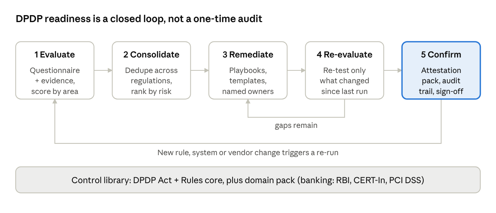
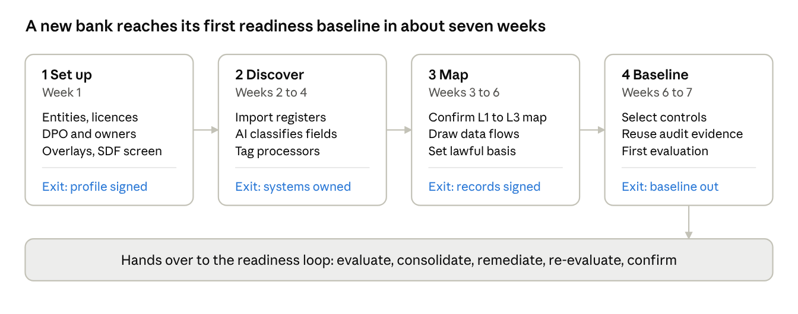
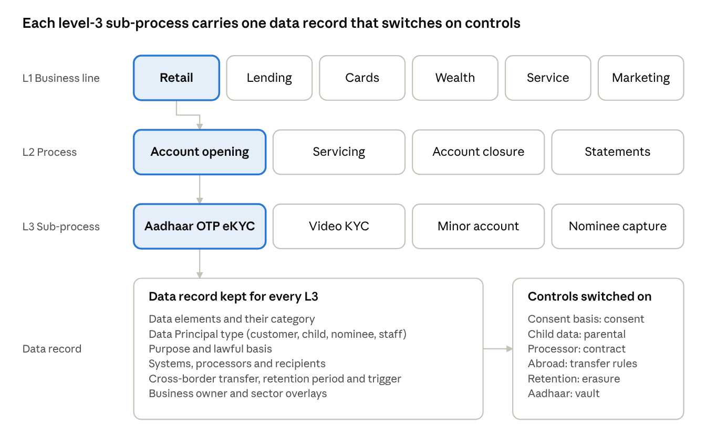

# CS34: DPDP Act Readiness Automation for Banks and NBFCs

**Domain: Banks, NBFCs and digital lenders; designed to extend to insurance, healthcare, telecom and e-commerce** · Org type: both

> **In short**
> - **The problem:** India's DPDP Act core duties apply from May 2027, and most banks and NBFCs still track readiness in workshops and spreadsheets.
> - **The approach:** a closed readiness loop (evaluate, consolidate, remediate, re-evaluate, confirm) on a process-level data map, with RBI, CERT-In and PCI DSS overlays.
> - **The proof:** a first readiness baseline for a new bank in about seven weeks, with exit gates at each phase.
> - **For your team:** this is the basis of my **compliance readiness sprint**.

## 1. Problem statement

India's Digital Personal Data Protection Act, 2023 and the DPDP Rules, 2025 apply their core duties to every Data Fiduciary from May 2027, yet most banks and NBFCs still measure readiness through one-off consultant workshops and spreadsheets. The law is principle-based: it says what outcome to reach (valid consent, purpose limitation, reasonable safeguards, erasure) but not how, so each institution has to turn it into controls, evidence and owners itself. In a bank this sits on top of RBI, PMLA, CERT-In, SEBI CSCRF and PCI DSS rules that overlap with DPDP and sometimes conflict with it, such as KYC record retention versus DPDP erasure. Personal data is spread across core banking, cards, lending, call centres, data lakes and fintech partners, with no process-level data map. Assessments produce long findings lists without owners or step-by-step fixes, evidence is scattered, and readiness decays as soon as a new product, vendor or rule clarification arrives. Institutions need a repeatable, evidence-backed process that evaluates, consolidates gaps, guides remediation, re-evaluates and lets a named officer attest readiness, and that keeps doing so.

## 2. Why now

| Incident or driver | What happened | Lesson |
|---|---|---|
| **DPDP Rules, 2025 notified (Nov 2025)** | Staggered rollout: Data Protection Board and procedures at once, Consent Manager obligations after 12 months (Nov 2026), core Data Fiduciary duties after 18 months (May 2027) | The window to build a readiness process, not a one-off report, is now |
| **DPDP penalty schedule** | Up to INR 250 crore per instance for failing to take reasonable security safeguards; up to INR 200 crore for breach-notification and children's-data failures | Exposure is set per obligation, so gaps can be ranked by penalty ceiling |
| **Breach reporting overlap** | DPDP requires notice to the Board and affected people, with a detailed report within 72 hours; CERT-In requires reporting within 6 hours; RBI has its own incident reporting | Three clocks and three formats must run from one runbook (see CS18) |
| **RBI Digital Lending Directions** | Explicit borrower consent, limits on app access to contacts and media, and oversight of Lending Service Providers (LSPs) | For NBFCs the main DPDP risk sits with partners and apps, not the core system |

Large banks are likely to be notified as Significant Data Fiduciaries (SDFs), which adds a DPO based in India, an annual Data Protection Impact Assessment (DPIA) and an independent data audit. Penalty amounts and overlaps above are summarised from public commentary; verify against the Act's Schedule and current RBI Master Directions before client use.

## 3. Pain points addressed

| Product organisations | Services organisations |
|---|---|
| PP-P-34 banking and lending apps must show itemised consent, honour withdrawal across partners and erase data on time under DPDP | PP-S-29 DPDP readiness is delivered as point-in-time consulting that goes stale; every bank client asks for the same mapping again |
| PP-P-19 regulator-driven timelines (RBI, SEBI CSCRF) passed through to fintech partners | PP-S-07 RBI outsourcing, SEBI CSCRF and now DPDP processor evidence requested by every BFSI client |
| PP-P-31 fintechs depend on sponsor banks and vendors they cannot audit deeply | PP-S-08 incident reporting clocks (CERT-In 6h) now joined by DPDP breach notification |

## 4. Root causes

1. **No process-level data map.** Systems are inventoried, but no one records which business process uses which personal data, for what purpose, on what lawful basis and for how long.
2. **Regulations mapped one at a time.** DPDP, RBI, PMLA, CERT-In, SEBI CSCRF and PCI DSS each get their own assessment, so the same control is tested many times and conflicts go unnoticed.
3. **Findings without owners or playbooks.** Gap lists name problems, not the next step, the owner or what "done" looks like.
4. **Evidence lives elsewhere.** RBI IS audits, PCI reports on compliance and ISO 27001 statements of applicability already prove many safeguards, but are not reused.
5. **No trigger to re-assess.** New products, vendors and Board guidance change the picture, but readiness is only measured once a year.

## 5. Solution

### 5.1 A closed readiness loop over one control library

Every stage reads from one control library: the DPDP core (about 10 obligation areas, each control traced to its clause) plus a sector overlay pack. Remediation loops through re-evaluation until no gaps remain, and any change to rules, systems or vendors restarts evaluation. Scores are computed by fixed rules from evidence; AI never sets a score.

| Stage | Output | Who signs |
|---|---|---|
| 1 Evaluate | Maturity score (0 to 4) per control with evidence, rolled up by process, business line and obligation area | Control owner |
| 2 Consolidate gaps | One register, deduplicated across DPDP and sector rules, ranked by penalty ceiling and effort | DPO |
| 3 Remediate | Playbook per gap: steps, templates, acceptance evidence, owner | Gap owner, Legal for wording |
| 4 Re-evaluate | Re-test only controls whose evidence, systems or rules changed | Control owner |
| 5 Confirm | Readiness gate and attestation pack for the Board | DPO, then Board noting |

### 5.2 Onboarding a new private bank

Onboarding is phase zero: it turns what the bank already has into a confirmed process and data map, then runs the first evaluation. Discovery and mapping run business line by business line, starting with retail and lending. Week counts are an indicative plan for a mid-size bank, not a benchmark.

| Input from the bank | Pre-fills | AI role |
|---|---|---|
| Legal entity and licence list, org chart | Tenant profile, overlays, DPO and owners | None |
| CMDB or IT asset register | Systems list | Suggests which systems hold personal data |
| Data dictionaries and schemas (metadata only) | Data elements and categories per system | Classifies fields; owner confirms |
| Vendor and outsourcing register | Processors and recipients | Flags likely processors |
| Existing RoPA or ISO 27701 records | Process records | Matches to the banking process catalogue |
| SOPs for KYC, lending, cards, collections | Sub-process activities and data flows | Extracts steps and data touchpoints |
| RBI IS audit, PCI DSS RoC, ISO 27001 SoA, CERT-In audit | Safeguard control evidence | Maps findings to DPDP controls |
| Privacy notices, consent screens, contracts | Notice, consent and processor evidence | Reviews for DPDP clauses |
| Incident and grievance registers | Breach and rights baseline | Summarises trends |

### 5.3 Three-level process and data model

The banking domain pack ships a process catalogue three levels deep (design target: about 8 business lines, 30 processes, 120 sub-processes), so a new bank edits a ready map instead of starting blank. Each level-3 sub-process carries one data record, and that record switches on the controls that apply.

| Path (L1 › L2 › L3) | Key data elements | Lawful basis | Systems and recipients | Retention trigger | Controls switched on |
|---|---|---|---|---|---|
| Retail › Account opening › Aadhaar OTP eKYC | Name, DOB, address, Aadhaar number (vaulted), photo, PAN, mobile | Legitimate use: compliance with law (PMLA, RBI KYC) | Onboarding app, core banking, Aadhaar data vault; UIDAI via ASA/KUA; CKYC registry | 5 years after relationship ends | Notice, Aadhaar vault security, retention and erasure |
| Retail › Account opening › Video KYC (V-CIP) | Live video, geo-tag, ID document image, PAN | Legitimate use: compliance with law | V-CIP platform run by a vendor | As per RBI KYC | Processor contract, safeguards, breach, retention |
| Retail › Account opening › Minor account | Child's name and DOB, guardian ID and relationship | Verifiable parental consent | Core banking | Account closure + statutory period | Children's data, no tracking or targeted ads |
| Retail › Account opening › Nominee capture | Nominee name, relationship, DOB | Legitimate use under banking law; data comes via the customer | Core banking | With the account | Notice to third parties, accuracy |
| Lending › Origination › Account Aggregator fetch | Bank statements, income patterns | Consent via an RBI-licensed Account Aggregator | Loan origination, analytics vendor | Loan life + statutory period | Consent, withdrawal, processor contract |
| Lending › Collections › Field agents | Borrower contact, address, overdue amount, reference contacts | Consent in loan agreement (confirm with counsel) | Collection agency (processor), dialler | Until closure + dispute window | Processor contract, safeguards, grievance |
| Cards › Transactions › Authorisation | Card number, transaction data (no CVV stored) | Legitimate use: service requested by the customer | Card platform, card network | PCI and RBI rules | PCI evidence reuse, payment data localisation, cross-border |
| Marketing › Cross-sell › Propensity models | Product holdings, transactions, demographics | Consent only; no legitimate use covers it | Data lake, campaign tool | Until consent is withdrawn | Itemised consent, withdrawal, purpose limitation |

Lawful-basis calls are sample mappings and need legal review before client use.

### 5.4 Sector overlays: assess once, satisfy many

| DPDP area | Banking overlap | Tension to resolve |
|---|---|---|
| Retention and erasure | RBI KYC Master Direction and PMLA: keep records 5 years after the relationship ends | Erase on purpose fulfilment vs statutory retention; DPDP defers to other law, then erasure applies |
| Breach notification | CERT-In 6-hour reporting; RBI incident reporting | One runbook, three clocks and formats |
| Processors and vendors | RBI outsourcing and IT outsourcing directions | Add DPDP processor clauses to existing contracts and due diligence |
| Security safeguards | RBI IT governance direction, SEBI CSCRF, PCI DSS | Reuse existing control evidence instead of re-assessing |
| Consent | RBI Digital Lending Directions | Align consent artefacts and withdrawal across apps and partners |
| Cross-border transfer | RBI payment data storage | The stricter sector rule prevails over DPDP's negative-list approach |
| Governance | SDF designation likely for large banks | DPO in India, annual DPIA and independent audit |

### 5.5 AI-assisted steps with guardrails

The rule is **AI suggests, humans attest**: AI speeds up reading, mapping and drafting; scores come from fixed rules; every readiness claim is signed by a named person.

| Step | AI assist | Value | Risk | Control |
|---|---|---|---|---|
| Onboard and evaluate | Classify personal data from schemas and data dictionaries; draft level-3 records from SOPs | Data map in weeks, not months | Misclassification; real personal data sent to a model | Metadata or masked samples only, India-hosted model, owner signs each record |
| Consolidate | Map clauses across DPDP, RBI, CERT-In, SEBI CSCRF and PCI DSS | One control instead of five duplicates | Invented or wrong citations | Every mapping links to the source clause; compliance approves the library |
| Consolidate | Review vendor and LSP contracts for processor clauses | Hundreds of contracts screened quickly | Missed clause or a false pass | AI can flag a gap, never pass a control; sample-based human QA |
| Remediate | Draft notices, consent text and contract clauses, including Eighth Schedule languages | Plain-language drafts fast | Legally inaccurate wording | Legal approval gate before use |
| Confirm | Write the Board readiness summary | Clear narrative | Overstated readiness | Numbers come from the engine; DPO signs off |

The tool itself processes personal data, so it is a Data Processor for each client and needs its own contract, safeguards and breach process. Uploaded documents can carry prompt-injection text, so AI output is treated as a suggestion, never an action (see CS04 and CS15).

### 5.6 Product organisation variant (NBFCs, digital lenders and fintech apps)

The same engine produces a different gap profile: the bank's biggest risk is legacy data and retention conflicts; the NBFC's is data flowing through lending partners and apps.

| Dimension | Private bank | NBFC with digital lending |
|---|---|---|
| Sector regulation | RBI as a bank; SEBI CSCRF for its broking, depository or AMC arms | RBI scale-based regulation and Digital Lending Directions; SEBI CSCRF only if a SEBI-registered intermediary |
| Data footprint | Deposits, cards, KYC, wealth, call-centre recordings, decades of legacy records | App onboarding, device data, bureau pulls, alternate data for underwriting |
| Third parties | Core banking, card processors, business correspondents, outsourced call centres | LSPs, fintech apps, co-lending partners, collection agents |
| Consent | Large legacy base with no DPDP-grade consent | In-app consent per loan; withdrawal must reach every LSP; no contacts or media access |
| PCI DSS | In scope for issuing and acquiring | Only if it issues cards or stores card data |
| SDF likelihood | High | Depends on volume; upper-layer NBFCs likely |
| Top gap themes | Retention vs erasure, legacy mapping, minors' accounts | Processor contracts, app permissions, collections data sharing, grievance handling |

For app builders, the levers are product controls: consent and withdrawal as API events every partner must honour, permissions limited to what the loan needs, and erasure jobs tied to loan closure.

### 5.7 Services organisation variant (consultancies and IT services firms)

Firms that run DPDP programmes for many banks reuse the DPDP core and the banking domain pack across clients and keep each client as a separate tenant with its own map, evidence and sign-offs. New sectors are content additions: insurance (IRDAI), healthcare (ABDM and clinical records), telecom (DoT, TRAI), e-commerce and edtech (children's data heavy), and HR data for any employer. The firm is itself a processor for each client, so its own access, AI use and breach process are in scope.

### 5.8 Demo: mockups and clickable prototype

Design mockups exist for six screens (overview, organisation profile, evaluate a control, gap register, remediation playbook, re-evaluate and confirm) and an interactive prototype covering onboarding, the data and process map and the full loop, switchable between a sample private bank and a sample NBFC. A walkthrough of the prototype is available on request. All names and numbers in it are sample data.

## 6. 90-day plan

| Days | Deliverable |
|---|---|
| 0-30 | DPDP core control library with clause traceability; banking overlay pack (RBI, PMLA, CERT-In, SEBI CSCRF, PCI DSS); onboarding phases 1-2 for the pilot bank; systems owned |
| 30-60 | Level 1-3 map signed for retail and lending; first evaluation with reused audit evidence; consolidated gap register with owners |
| 60-90 | Playbooks for the critical gaps (retention vs erasure, breach runbook, processor contracts, legacy consent); first re-evaluation; DPO readiness gate and Board pack; NBFC pack drafted |

## 7. KPIs

| KPI | Target |
|---|---|
| DPDP Act and Rules obligations traced to at least one control | 100% |
| Level-3 sub-processes with a signed data record | ≥ 90% before attestation |
| Overlapping controls assessed once and reused | Duplicate count shown; no control tested twice in a cycle |
| Critical gaps open at attestation | 0 |
| Readiness score at attestation | ≥ 85% in every obligation area |
| AI suggestions applied without a named human decision | 0 |
| Time from a rule, system or vendor change to re-evaluation | ≤ 30 days |

## 8. Tooling options

- **Open source / free:** the DPDP Act and Rules text, RBI Master Directions and SEBI circulars as the clause source; NIST Privacy Framework and ISO/IEC 27701 as control references; OSCAL for machine-readable control catalogues; data catalogues and open-source data discovery for metadata classification.
- **Commercial categories:** privacy management platforms (RoPA, DPIA, consent and rights workflows), data discovery and classification, consent managers registered under DPDP, GRC platforms for evidence and attestations.

## 9. Risks and how to handle them

| Risk | Mitigation |
|---|---|
| Interpretation errors become controls | Clause traceability, compliance review of the library, interpretation flags routed to counsel |
| Statutory retention and erasure conflict | Retention rule per level-3 record with the overriding law named; erasure starts when the longest legal hold ends |
| Owners sign records they have not checked | Sample-based review by the DPO office and internal audit; re-sign on change |
| AI misclassifies data or drafts a wrong clause | Owner confirmation, Legal gate, AI never passes a control |
| The readiness tool becomes a new breach path | Metadata and masked samples only, tenant isolation, processor contract, India hosting |
| Readiness decays after attestation | Change triggers and a quarterly re-evaluation; expired evidence reopens controls |

## 10. Learnings

1. DPDP readiness starts with a process-level data map; without lawful basis and retention per sub-process, consent and erasure cannot be assessed.
2. Banks already hold most safeguard evidence in RBI, PCI and ISO audits; reuse it and spend effort on consent, notice, erasure and processors.
3. One control library with sector overlays avoids testing the same control five times and surfaces conflicts such as KYC retention versus erasure.
4. A gap without an owner, a playbook and acceptance evidence is not a plan.
5. AI is useful for reading and drafting at scale, provided every score is rule-based and every claim is signed by a named person.

## References

- Digital Personal Data Protection Act, 2023 and DPDP Rules, 2025 (MeitY): https://www.meity.gov.in/
- Hogan Lovells, "India's Digital Personal Data Protection Act 2023 brought into force": https://www.hoganlovells.com/en/publications/indias-digital-personal-data-protection-act-2023-brought-into-force-
- EY, "DPDP Rules, 2025": https://www.ey.com/en_in/insights/cybersecurity/transforming-data-privacy-digital-personal-data-protection-rules-2025
- RBI Master Direction, Know Your Customer (KYC) Direction, 2016 (as amended): https://www.rbi.org.in/
- RBI Master Direction on IT Governance, Risk, Controls and Assurance Practices (2023) and Outsourcing of IT Services (2023): https://www.rbi.org.in/
- RBI Digital Lending Directions: https://www.rbi.org.in/
- CERT-In Directions of 28 April 2022 (6-hour incident reporting): https://www.cert-in.org.in/
- SEBI Cybersecurity and Cyber Resilience Framework (CSCRF), 2024: https://www.sebi.gov.in/
- PCI DSS v4.0.1: https://www.pcisecuritystandards.org/
