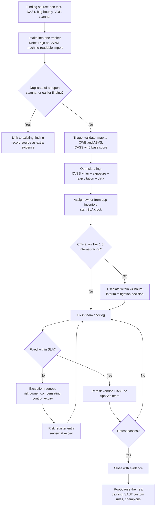

# CS53: Designing a Security Testing Programme Beyond Scanners

Domain: Large enterprises with in-house engineering (manufacturing, BFSI, SaaS, healthcare, public sector); IT services firms and testing providers · Org type: both

> **Point of view: a design case study.** This is how I would build a security testing programme for a large enterprise. It is not a record of a programme I ran. I have **not** run penetration tests, managed pen-test vendors, run a bug bounty or used DAST in production. Where the design reuses things I did run as AGM, Application Security and Vulnerability Management (SLA policy, exception process, risk registers, security champions, scanner metrics), the text says so and marks it **Based on real experience**. Everything else is design. It complements [CS47](../CS47-Penetration-Testing-Programme-Management/README.md), which covers running individual pen-test engagements; this case study decides *which* testing each application gets and *how the findings get fixed*. Methodology-level only: no exploit steps, payloads or tool commands.

### What is real and what is design

| Part of this case study | Status | Source |
|---|---|---|
| Scanner programme at scale (GHAS CodeQL, secret scanning with push protection, Mend SCA, Qualys VMDR, Microsoft Defender VM) | **Based on real experience** | 10,000+ developers, 55,000+ repositories; about 600 secrets blocked by push protection; Defender VM coverage 96% |
| Severity-based SLA policy and its enforcement | **Based on real experience** | I owned and enforced it; GHAS SLA compliance moved from 35% to about 70% |
| Exception process | **Based on real experience** | I owned the exception process for AppSec and VM findings |
| Risk registers and a 100-member security champions network | **Based on real experience** | I ran both |
| Tool rationalisation | **Based on real experience** | Replaced a commercial SAST tool, removing $990K a year of licence cost |
| DAST, pen test, bug bounty, VDP, red team, vendor management | **Design** | Built from public standards (OWASP WSTG, ASVS, PTES, NIST SP 800-115, CVSS) |
| Numbers for tiers, costs and targets | **Illustrative** | Labelled where used; not from any employer |

## 1. Problem statement

A large enterprise with about 55,000 repositories and 10,000 developers already runs SAST, SCA and secret scanning at scale. The scanners work. Findings flow, SLAs exist and compliance is improving. Leadership now asks three questions:

1. What security testing do we need beyond scanners?
2. How do we choose the right testing for each application?
3. How do findings from that testing actually get fixed?

Today the answer is patchy. Some business units buy a pen test each year because an auditor or a customer asked. Others never test. Reports arrive as PDFs and sit outside the tracker that holds scanner findings, so they have no owner, no SLA and no retest. Nobody can say which flaws the scanners miss, so nobody can say whether the pen-test spend is buying anything. Some teams ask for a bug bounty because a competitor launched one, without the triage capacity to run it.

The question this case study answers: **how do we design a risk-tiered security testing programme that adds human and runtime testing where scanners are blind, and feeds every finding into the same VM process, SLAs and exceptions that already work for scanner findings?**

## 2. Why now

| Driver | What is happening | What it means for the design |
|---|---|---|
| **Scanners are mature, but blind to a class of flaws** | SAST, SCA and secret scanning find code patterns and known components. They do not understand business intent, so authorisation flaws (IDOR, BOLA), business logic abuse and chained attacks pass through. Broken access control is A01 in the OWASP Top 10 (2021 and 2025 lists) | The next pound or rupee should go to testing that reasons about behaviour, not more of the same scanning |
| **Regulation asks for testing and evidence** | PCI DSS v4.0.1 requirement 11.4: penetration testing at least annually and after significant change, with a documented methodology and retest. DORA threat-led penetration testing for designated financial entities. SEBI CSCRF VAPT requirements in India | Testing must be planned, tiered and evidenced, not ad hoc |
| **Release cadence outran the annual test** | Product teams ship weekly or daily | An annual pen test needs DAST on each release in between, and change-based triggers for off-cycle tests |
| **AI made discovery cheap, and noisy** | AI-assisted testing finds more issues faster; some open-source projects closed bug bounties because of low-quality AI-generated reports (curl, January 2026; see CS51) | Bug bounty readiness now depends even more on triage capacity |
| **Budget pressure** | Leaders expect tool spend to show outcomes ([CS50](../CS50-Security-Tool-Adoption-and-Vendor-Scaling/README.md)) | Every testing type needs a cost-per-valid-finding and a "what did scanners miss" metric |

## 3. Pain points addressed

| Product organisations | Services organisations |
|---|---|
| **PP-P-51** testing beyond scanners is bought ad hoc: no risk tiering decides which applications get DAST, pen tests or bug bounty; findings arrive as PDFs outside the scanner tracker, with no owner, SLA, retest or dedup, and nobody measures what scanners miss | **PP-S-46** testing providers and managed AppSec teams deliver reports that clients cannot ingest: severity scales differ from client risk ratings, findings are not mapped to CWE or ASVS, retest terms are vague, and the value over scanners is not shown |
| PP-P-44 pen tests scoped by budget and calendar; findings in PDFs | PP-S-39 fixed-fee tests scoped on vague inputs; retest scope creep |
| PP-P-12 API sprawl and broken object-level authorisation | PP-S-10 client blames the vendor for findings in delivered code |
| PP-P-06 AppSec to developer ratio of 1:100 or worse | PP-S-05 skills shortage; junior staff triage without context |
| PP-P-47 tools bought faster than they are absorbed | PP-S-45 effort-priced testing under AI price pressure |

## 4. Root causes

1. **No tiering model.** Every application is treated the same, so testing depth follows who asks loudest rather than risk.
2. **Testing types are seen as substitutes.** "We have DAST, so we do not need a pen test" or the reverse. They find different things.
3. **Two tracks for findings.** Scanner findings go to the tracker; pen-test findings go to email and PDFs. The second track has no SLA.
4. **Severity is not translated.** A vendor's "High" is treated as business risk, with no adjustment for exposure, data or tier.
5. **No feedback loop.** The same flaw class comes back every year because nobody turns findings into training, SAST custom rules or champion topics.
6. **No measure of value.** Nobody tracks the pen-test delta (what humans found that scanners missed), so the budget cannot be defended or tuned.
7. **Bug bounty launched on hope.** Programmes start before the VM process can absorb the volume.

## 5. Solution: the security testing programme

The programme has four layers. Each layer covers what the one below cannot see.

```
Layer 4  Crowd: VDP for everyone, private then public bug bounty for ready Tier 1 assets
Layer 3  Human: grey-box pen test by risk tier, plus off-cycle triggers
Layer 2  Runtime: DAST (and IAST where it fits) on running applications
Layer 1  Code: SAST, SCA, secret scanning on every repository   <- already in place
```

Everything feeds one intake, one risk rating, one SLA policy and one exception process (section 5.7).

### 5.1 Testing types compared

| Testing type | What it finds well | What it misses | When in the SDLC | Cost and effort | False-positive profile |
|---|---|---|---|---|---|
| **SAST** (for example CodeQL) | Injection, unsafe deserialisation, path traversal, weak crypto use; data-flow issues in code | Business logic, authorisation intent (IDOR), auth flow design, runtime and configuration issues, chained attacks | Pull request and main branch | Low per scan once licensed; tuning effort is the real cost | Medium to high until tuned; custom rules help |
| **SCA** (for example Mend) | Known vulnerable open-source components, licence issues | Whether the vulnerable function is reachable; first-party flaws; logic and config | Pull request, build, and continuously as new CVEs land | Low per scan; triage of transitive findings is the cost | Medium; high without reachability or exploitation context |
| **Secret scanning** (with push protection) | Hard-coded keys, tokens and passwords | Secrets outside the repo (CI logs, tickets, images); misuse of valid credentials | Pre-commit and push; historical scans | Low | Low for provider patterns; higher for generic patterns |
| **DAST** (for example ZAP) | Reflected issues, missing security headers, cookie flags, some injection, TLS and server misconfiguration, exposed files | Most business logic, multi-step workflows, IDOR across users unless scripted, anything behind complex SSO it cannot log in to | Test or staging environment on each release; scheduled scans on production-like targets | Low to medium; authenticated scanning and API definitions take set-up effort | Medium; needs triage, but evidence is a real HTTP request and response |
| **IAST** (brief) | Runtime-confirmed injection and data-flow issues during functional tests, with code location | Code paths that tests never exercise; logic flaws | QA and integration testing | Medium; agent per language and runtime | Low, because it observes real execution |
| **Manual pen test** (grey-box) | Authorisation flaws (IDOR, privilege escalation), business logic abuse, auth and session flow weaknesses, chained attacks, configuration in context | Breadth: covers a sample of the application in a fixed window; regressions after the test | Before major release; annually by tier; on triggers | High: typically 5 to 15 tester days per application **(illustrative)** | Low; findings are validated by a person, but quality varies by tester |
| **Red team** (brief, out of scope here) | Whether people, process and detection stop a goal-based attacker across the organisation | Breadth of application flaws; it is not an application test | Periodic, organisation level, once detection is mature | Very high | Low; output is a narrative and detection gaps |
| **VDP** | Issues found by well-meaning outsiders on any public asset | Anything nobody outside chooses to look at; no guaranteed coverage | Always on | Low: a policy, a safe harbour, an intake and triage | High share of low-value or out-of-scope reports |
| **Bug bounty** | Creative, real-world issues on internet-facing assets, including logic and auth flaws; continuous | Internal apps; deep business logic that needs domain knowledge; anything out of scope | Continuous, after the VM process is mature | Medium to high: platform fee plus bounties plus triage time | High noise (duplicates, out of scope, AI-generated reports) unless a managed triage service filters it |

**How to read it.** Scanners give breadth. DAST checks the running application. Humans find the flaws that need understanding of intent: who should see which record, which step can be skipped, which two low findings chain into one critical. That last group is what this programme is buying.

### 5.2 Choosing by risk tier

**Tiering model (design).** Each application gets a tier from four questions. The answers come from the application inventory, owned by the application owner and reviewed yearly.

| Factor | Question | Points |
|---|---|---|
| Exposure | Internet-facing, or reachable by customers or partners? | Yes = 3 |
| Data | Handles personal, payment, health or confidential business data? | Yes = 3 |
| Regulation | In scope for PCI DSS, DORA, SEBI CSCRF, RBI, HIPAA or similar? | Yes = 2 |
| Business impact | Revenue-critical, safety-relevant or a shared platform many apps depend on? | Yes = 2 |

Tier 1: 7 points or more. Tier 2: 4 to 6. Tier 3: 0 to 3. A regulated, internet-facing app with sensitive data is always Tier 1.

| Tier | Typical share of apps **(illustrative)** | Scanners (SAST, SCA, secrets) | DAST | Manual pen test | Bug bounty / VDP | Threat model |
|---|---|---|---|---|---|---|
| **Tier 1** | 5% | Every PR, blocking on Critical | Authenticated DAST on every release, plus weekly on staging | Annual grey-box test, plus off-cycle triggers | Covered by VDP; private bug bounty once ready (5.3) | Yes, refreshed on major change |
| **Tier 2** | 20% | Every PR | Authenticated DAST monthly or on major release | Every two years, or a lighter targeted test on triggers | Covered by VDP | On major change |
| **Tier 3** | 75% | Every PR | Optional unauthenticated baseline | No routine test; only on trigger | Covered by VDP | No |

**Off-cycle pen-test triggers.** Any of these moves an application into a test, whatever its calendar:

- A major release that changes architecture, data flows or exposure.
- A new or changed authentication or authorisation flow (new SSO, MFA, API keys, role model).
- A new internet-facing interface or public API.
- Merger, acquisition or onboarding of a third-party-built application.
- A security incident or confirmed exploitation affecting the application or its component class.
- A regulatory or customer requirement with a date.
- A material change in the data the application holds.

**When not to run a pen test.** When the application is Tier 3 with no trigger. When scanner and DAST findings above Medium are still open and past SLA: fix the known issues first, or the testers spend paid days rediscovering them. When the environment is not ready (no test accounts, no stable build). And when the real question is about detection or people, which is a red-team or tabletop question, not an application test.

### 5.3 When a bug bounty makes sense

**Readiness criteria (design).** A bug bounty adds a new, external source of findings. It only helps if the organisation can absorb them.

| Criterion | Ready when | Why |
|---|---|---|
| VM process is mature | One tracker, owners on every finding, working exception process | Bounty findings need the same path as every other finding |
| SLAs are met | Critical and High SLA compliance is consistently high for in-scope assets (for example 85% or more, **illustrative**) | If internal findings rot, paid external ones will too |
| Pen tests are done | In-scope assets have had at least one grey-box test with findings fixed | Do not pay bounties for issues a pen test would have found cheaper |
| Triage capacity | A named team, or a managed triage service, can respond within days | Slow responses lose researcher trust and raise duplicates |
| Asset inventory | Scope can be stated precisely | Unclear scope leads to out-of-scope testing and disputes |
| Legal and comms | Safe harbour wording, disclosure policy and payment process agreed | Protects researchers and the organisation |

**The path.**

1. **VDP first.** Publish a vulnerability disclosure policy and a `security.txt` file. Offer safe harbour, an intake channel and response times. No payments. Align with ISO/IEC 29147 (disclosure) and ISO/IEC 30111 (handling).
2. **Private before public.** Invite a small group of vetted researchers to a few Tier 1 assets. Learn the volume, noise and fix rate.
3. **Public only when private works.** Widen scope and audience once SLAs for bounty findings are met for two to three quarters.

**Managed platform versus self-run.** A managed platform brings researcher reach, payments, legal terms and optional triage. It costs a platform fee. Self-run is cheaper on paper but needs in-house triage, payment handling and researcher relations. For an enterprise starting out, a managed platform with triage is the safer default. Self-run fits organisations that already have a strong PSIRT.

### 5.4 Scoping and rules of engagement

One page, signed before any testing. It extends the [CS47 rules of engagement checklist](../CS47-Penetration-Testing-Programme-Management/governance-templates.md).

> **Scope and rules of engagement: template**
>
> | Item | Entry |
> |---|---|
> | Application and tier | `<name>`, Tier `<1/2/3>`, application owner `<name>`, risk owner `<name>` |
> | Test objective | One sentence, for example "Can one customer view or change another customer's orders?" |
> | Method and knowledge level | Grey-box; OWASP WSTG test areas `<list>`; requirement baseline ASVS level `<1/2/3>` |
> | In-scope assets | URLs, hostnames, API base paths, mobile app builds, with versions |
> | Out-of-scope assets | Third-party SaaS, payment processor pages, shared infrastructure, production databases, named hosts |
> | Environments | Staging `<URL>` (default); production only for named read-only checks, with written approval |
> | Test accounts and roles | At least two accounts per role (to test cross-user access), including admin and lowest-privilege roles; synthetic data only |
> | Testing windows | Dates, hours and time zone; change freeze dates excluded |
> | Prohibited actions | Denial of service or load testing; data exfiltration beyond the minimum proof; social engineering, phishing or physical access unless agreed in writing; changing or deleting data not created by the tester; persistence or malware |
> | Data handling | No real personal data stored; evidence encrypted at rest and in transit; deleted within `<30>` days of report acceptance, with written confirmation |
> | Emergency stop and contacts | Named contacts on both sides with phone numbers, available during windows; either side can stop testing at once |
> | SOC deconfliction | Source IPs and test window shared with the SOC; SOC records what it detected |
> | Critical-finding escalation | Any Critical, or any finding showing real data exposure, reported by phone and secure message **within 24 hours**, not held for the report |
> | Reporting | Draft within `<5>` working days; findings mapped to CWE, OWASP Top 10 and ASVS requirement; CVSS v4.0 vector; reproduction steps for the fixing team |
> | Retest terms | One retest of all Critical and High findings within `<90>` days included in the fee; retest report states fixed, partly fixed or not fixed with evidence |
> | Authorisation | Signed by the asset owner with authority; hosting and cloud provider terms checked |

### 5.5 Methods and knowledge level

**Which standard for what.**

| Standard | What it is | Use it for |
|---|---|---|
| **OWASP ASVS** (v5.0, 2025) | A list of security requirements an application should meet, at three levels | The **baseline**: what "secure enough" means per tier. Tier 1 targets Level 2 (Level 3 for the most critical), Tier 2 targets Level 2 for key areas, Tier 3 Level 1 |
| **OWASP WSTG** | A web testing guide: how to test each area (authentication, authorisation, session, input, business logic) | The **test method** for web and API tests; vendors state which WSTG areas they covered |
| **PTES** | A penetration test execution standard: phases from pre-engagement to reporting | The **engagement structure** for wider tests (network, infrastructure, mixed scope) |
| **NIST SP 800-115** | A guide to planning and running security testing and assessments | The **programme and governance** reference: planning, rules, data handling, reporting |
| **CVSS v4.0** | A common way to score technical severity | The **technical severity** input to our risk rating (5.7) |

Short version: ASVS says what good looks like, WSTG says how to test a web app, PTES says how to run an engagement, NIST SP 800-115 says how to run testing as an organisation, and CVSS gives a common technical score.

**Knowledge level.**

| Level | What the tester gets | Strengths | Weaknesses |
|---|---|---|---|
| Black-box | A URL and nothing else | Shows what an outside attacker sees first | Days spent on discovery; shallow coverage of authenticated and authorisation logic |
| **Grey-box (default)** | Test accounts for each role, API definitions, architecture overview, a walkthrough | Best coverage per tester day; tests authorisation between users and roles, which is where scanners are weakest | Less "realistic" for the outside-in view |
| White-box | Source code, design documents, engineers on call | Deepest coverage; good for crypto, auth libraries and high-value logic | Most expensive; needs code access agreements |

**Recommendation: grey-box as the default.** The flaws this programme pays humans to find (IDOR, privilege escalation, business logic, auth flows) need valid accounts in more than one role. Black-box spends the budget on discovery that the asset inventory and DAST already do. Use white-box selectively for Tier 1 components like authentication services, payment logic or cryptography, where source access lets a tester go deeper in the same days.

### 5.6 Pen-test vendor management

This section is design. I have not managed pen-test vendors. It applies the vendor and contract discipline I used when replacing a commercial SAST tool and running scanner platforms.

**Selection criteria.**

| Criterion | What good looks like | How to check |
|---|---|---|
| Methodology | Named standards (WSTG, PTES, ASVS mapping); test plan per engagement | Ask for the methodology document and a sample test plan |
| Tester quality | Named testers with recognised certifications (for example OSCP, CREST CRT or CCT, OSWE for web) and relevant experience | CVs of the actual testers, not the bench; right to approve substitutions |
| Accreditation | CREST membership or equivalent; CERT-In empanelment for Indian regulated work | Certificates and register checks |
| Report quality | Clear business impact, reproduction steps, CWE and ASVS mapping, CVSS vectors, fix guidance, no scanner dump | A redacted sample report scored against our template |
| Retest policy | Retest of Critical and High included within a stated window | Contract clause |
| Data handling | Encrypted evidence, deletion on schedule, no offshore transfer without approval, background-checked staff | Security questionnaire and contract clause |
| Commercials | Clear day rates, scoping method, change control | Compare cost per tester day and cost per valid finding over time |

**Panel and rotation.** Keep a panel of two or three approved vendors. Rotate the vendor on each Tier 1 application every two to three years so fresh eyes see it, while keeping continuity inside a cycle.

**SOW and SLAs.** Each statement of work names the scope and RoE (5.4), the tester names, the 24-hour critical escalation, report deadline, report format (machine-readable export as well as PDF), retest terms and data deletion.

**Quality review.** The AppSec team reviews each report before it is accepted: are findings reproducible, correctly rated, mapped, and free of unvalidated scanner output? Score each engagement 1 to 5 (CS47 scorecard). Two low scores in a row trigger a review of the vendor's place on the panel.

**Cost model (illustrative).**

| Item | Illustrative assumption |
|---|---|
| Grey-box web or API test | 5 to 15 tester days per application; blended day rate USD 1,000 to 1,500 (India-based providers often lower) |
| Tier 1 annual test | USD 10,000 to 25,000 per application |
| Retest | Included for Critical and High within 90 days |
| Pen-testing-as-a-service | Subscription per application or credit; useful for frequent retests and smaller Tier 2 tests |

### 5.7 Feeding findings into the VM programme

> **Based on real experience.** The SLA policy, exception process, risk registers, champions network and metrics below are the ones I owned and enforced for the scanner programme (GHAS, Mend, Qualys VMDR, Microsoft Defender VM). The design extends them to pen-test, DAST and bounty findings. The pen-test-specific parts (severity mapping from vendor ratings, retest evidence, pen-test delta) are design.

**Principle: one intake, one rating, one SLA, one exception process.** A pen-test finding is a finding. It goes where scanner findings go.



**Intake.** Every source lands in one tracker, for example DefectDojo or an ASPM platform, through a machine-readable import, not a copied PDF. The SOW requires vendors to deliver an export.

**Severity mapping.** Three ratings exist. Keep all three, but act on one.

| Rating | Who sets it | What it means | Used for |
|---|---|---|---|
| Vendor rating | Tester | Their judgement of severity | Input only |
| CVSS v4.0 base (with threat metrics where known) | Tester, checked by AppSec triage | Technical severity, comparable across sources | Input and reporting |
| **Our risk rating** | AppSec triage | CVSS adjusted for tier, exposure, active exploitation (for example CISA KEV) and data sensitivity | **Drives the SLA** |

For example, a CVSS High IDOR on a Tier 1 internet-facing app holding customer data is rated Critical. A CVSS High on an internal Tier 3 tool with no sensitive data may stay High or drop to Medium. The reason is recorded.

**Owner assignment.** The owner comes from the application inventory, the same mapping used for scanner findings. Findings without an owner go to the business unit's security champion to resolve within days, not weeks.

**Same SLA and exception process.** **Based on real experience:** one severity-based SLA policy for all sources (illustrative: Critical 30 days, High 60, Medium 90). Exceptions need a risk owner, a compensating control, an expiry date and a risk register entry. Design addition: an exception turnaround target of two weeks. **Design addition:** for Critical findings on Tier 1 or internet-facing apps, a 24-hour escalation and an interim mitigation decision (for example a WAF rule or feature flag) within 72 hours, while the 30-day fix clock runs.

**Retest and closure evidence.** A finding closes only with evidence: a vendor retest, an authenticated DAST check that targets the issue, or an AppSec team verification. The evidence is attached to the finding. "Developer says fixed" is not closure.

**Dedup against scanner findings.** At triage, check whether the same flaw (same CWE, same endpoint or code location) is already open from SAST, SCA or DAST. If so, link rather than duplicate. This is also how the pen-test delta is measured: a finding with no scanner match is a "scanner missed it" finding.

**Root-cause themes back into prevention.** Each quarter, group findings by CWE and team. Feed the top themes into:

- **Secure coding training**, with real (anonymised) examples from our own apps.
- **SAST custom rules**, for example CodeQL queries for a recurring missing authorisation check in a shared framework.
- **Champions**: **Based on real experience,** the 100-member champions network gets the top three themes as their quarter's focus.
- **Paved-road fixes**: a shared authorisation library or secure default that removes the class.

### 5.8 Product and services variants

| Product organisations | Services organisations |
|---|---|
| Own the tiering, the tracker and the fix. Use the design as written | Testing providers: deliver findings in the client's format (CWE, ASVS, CVSS v4.0 vector, machine-readable export), offer retest windows, and report the "beyond scanners" value per engagement |
| Customer and auditor evidence comes from the same tracker | Managed AppSec teams: run the intake, triage and dedup as a service across client estates, with per-client SLAs and exception owners |
| Share pen-test summaries with customers under NDA from the closed, retested state | Delivery teams building client code: agree in the contract who fixes pen-test findings and in which SLA |

## 6. Rollout plan

All budget figures are **illustrative**, for an estate of about 2,000 business applications behind the 55,000 repositories.

| Phase | Weeks | What happens | Output |
|---|---|---|---|
| **Days 0 to 30: foundations** | 1 to 4 | Agree the tiering model with risk and architecture; tier the top 200 applications by business criticality; extend the existing SLA and exception policy to all finding sources (**based on real experience**: same policy, same approvers); configure the tracker to import DAST and pen-test exports; publish the VDP and `security.txt` | Tiering standard, updated policy, VDP live |
| **Days 31 to 60: runtime and vendors** | 5 to 8 | Authenticated DAST in the release pipeline for the first 20 Tier 1 apps; vendor RFP with the criteria in 5.6; sign two or three panel vendors; RoE template approved by legal | DAST on Tier 1 pilot, vendor panel, signed RoE template |
| **Days 61 to 90: first tests and metrics** | 9 to 13 | First 8 to 10 Tier 1 grey-box tests; findings flow through the intake; first dashboard with coverage by tier, MTTR by source and pen-test delta; first root-cause review with champions | First evidence of the delta; dashboard live |
| **Months 4 to 12: scale** | | All Tier 1 apps tested annually; Tier 2 on its cycle; DAST on all Tier 1 and Tier 2; quarterly root-cause themes into training and SAST rules; review bug bounty readiness against 5.3 | Full coverage; bounty decision |
| **Year 2: crowd** | | Private bug bounty on 3 to 5 Tier 1 assets if ready; public only after two to three quarters of met SLAs | Bounty live or deferred with reasons |

**Illustrative annual budget (steady state).**

| Item | Assumption | Illustrative cost |
|---|---|---|
| Tier 1 pen tests | 100 apps x USD 15,000 average | USD 1.5M |
| Tier 2 pen tests | 400 apps every two years, lighter tests, USD 8,000 average | USD 1.6M over two years, about USD 0.8M a year |
| DAST tooling | Open source (ZAP) plus engineering time, or a commercial licence | USD 0 to 300K |
| Bug bounty (year 2) | Managed platform with triage, plus bounties | USD 150K to 400K |
| Triage and programme staff | 3 to 4 FTE AppSec engineers | Internal cost |

These are not employer figures. A useful framing for leadership: a mature scanner estate can often fund part of this from rationalisation. **Based on real experience,** replacing a commercial SAST tool removed $990K a year of licence cost in my last role; that is the scale of saving that makes a tiered testing budget a re-allocation, not only a new ask.

## 7. KPIs

| Metric | Definition | Why it matters | Target **(illustrative)** |
|---|---|---|---|
| Coverage by tier | % of Tier 1 / Tier 2 apps with an in-date pen test and active DAST | Shows the plan is executed | Tier 1: 100% pen test, 100% DAST |
| Mean time to remediate by source | MTTR for scanner, DAST, pen-test and bounty findings, by risk rating | Shows if one source rots | Within SLA for all sources |
| SLA compliance by source | % of findings fixed within SLA, by source and tier | **Based on real experience:** the metric I used for GHAS (35% to about 70%) | 85%+ for Critical and High on Tier 1 |
| **Pen-test delta** | % of valid pen-test findings with no matching scanner or DAST finding | Proves the value of human testing; guides scope | Track trend; expect most Critical and High to be in the delta |
| Retest pass rate | % of findings that pass first retest | Shows fix quality | 90%+ |
| Repeat findings | % of findings in the same CWE and app as last year | Shows if root-cause work lands | Falling year on year |
| Bug bounty signal-to-noise | Valid reports / total reports | Shows triage load and programme health | Rising over time |
| Cost per valid finding | Spend / valid Medium-and-above findings, by source | Compares pen test, DAST and bounty value | Used for budget decisions, not as a target |
| Exception age | Count and age of open exceptions from testing | Prevents permanent risk acceptance | No expired exceptions |

## 8. Tooling options

Vendor-neutral. See CS46 for a fuller comparison.

- **Finding aggregation:** DefectDojo (open source), or an ASPM platform that already ingests the scanners.
- **DAST:** ZAP (open source) for pipeline baselines and authenticated scans; commercial DAST where SSO, API coverage or scale needs it.
- **IAST:** language-agent tools where QA test coverage is strong.
- **Pen testing:** a panel of CREST-accredited or equivalent providers; pen-testing-as-a-service for retests and smaller tests.
- **Bug bounty and VDP:** managed platforms with triage, or a self-run VDP with `security.txt` and a ticket intake.
- **Inventory and tiering:** the application inventory or CMDB, enriched with exposure from attack surface management.

## 9. Risks and how to handle them

| Risk | Effect | Mitigation |
|---|---|---|
| Tiering gamed down to avoid testing | High-risk apps skip testing | Security reviews tier changes; regulated and internet-facing data apps are fixed at Tier 1 |
| Pen-test findings rot | Spend with no risk reduction | Same SLA, same exceptions, same dashboard as scanner findings; no separate track |
| Vendor quality drifts | Shallow tests, scanner dumps | Named testers, report quality review, scorecards, rotation |
| Testing breaks something | Outage or data damage | Staging by default, prohibited actions, emergency stop, SOC deconfliction |
| Bug bounty floods triage | Slow responses, researcher distrust, unpaid duplicates | Readiness gates, private first, managed triage |
| DAST noise in pipelines | Teams ignore or bypass it | Start non-blocking; tune; block only on validated high-confidence rules |
| Duplicate findings across sources | Double counting, wasted effort | Dedup at triage by CWE and location |
| Budget cut | Coverage drops | Tier 1 is protected; the pen-test delta and cost per valid finding defend the spend |

## 10. Lessons and risks

**Lessons (design principles).**

1. **Scanners give breadth; humans give depth.** Buy human testing for what scanners cannot reason about: authorisation, business logic, chained attacks.
2. **Tier first, then test.** The tier decides depth and frequency, not who shouts loudest.
3. **One finding pipeline.** A pen-test finding with no owner, SLA or retest is just an expensive PDF.
4. **Measure the delta.** If you cannot show what humans found that scanners missed, you cannot defend or tune the spend.
5. **Readiness before reach.** VDP before bounty, private before public, and only when SLAs are met.
6. **Close the loop.** Findings that do not change training, rules or defaults will come back next year.

## References

- OWASP, Web Security Testing Guide (WSTG) - https://owasp.org/www-project-web-security-testing-guide/
- OWASP, Application Security Verification Standard (ASVS) 5.0 - https://owasp.org/www-project-application-security-verification-standard/
- OWASP, Top 10 - https://owasp.org/www-project-top-ten/
- ZAP - https://www.zaproxy.org/
- PTES, Penetration Testing Execution Standard - http://www.pentest-standard.org/
- NIST, SP 800-115 Technical Guide to Information Security Testing and Assessment (2008) - https://csrc.nist.gov/pubs/sp/800/115/final
- FIRST, CVSS v4.0 Specification - https://www.first.org/cvss/v4-0/
- MITRE, CWE - https://cwe.mitre.org/
- CISA, Known Exploited Vulnerabilities Catalog - https://www.cisa.gov/known-exploited-vulnerabilities-catalog
- ISO/IEC 29147:2018 Vulnerability disclosure - https://www.iso.org/standard/72311.html
- ISO/IEC 30111:2019 Vulnerability handling processes - https://www.iso.org/standard/69725.html
- RFC 9116, security.txt - https://www.rfc-editor.org/rfc/rfc9116
- CISA, BOD 20-01 Develop and Publish a Vulnerability Disclosure Policy - https://www.cisa.gov/news-events/directives/bod-20-01-develop-and-publish-vulnerability-disclosure-policy
- PCI Security Standards Council, PCI DSS v4.0.1 - https://www.pcisecuritystandards.org/document_library/
- CREST - https://www.crest-approved.org/
- OWASP DefectDojo - https://owasp.org/www-project-defectdojo/
- The Register, curl ends bug bounty (Jan 2026) - https://theregister.com/2026/01/21/curl_ends_bug_bounty
